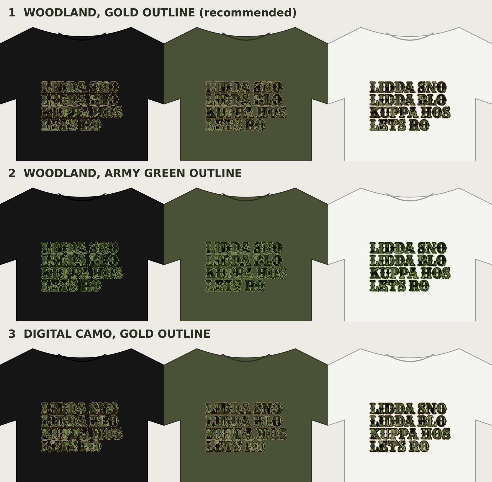

# Camo 01: Lidda Sno in green and black camo

The Lidda Sno shirt from Series 01, same words and same look: **LIDDA SNO / LIDDA BLO / KUPPA HOS / LETS RO** in big Rye western letters, four lines on one left edge, with an outer ring and a black inner ring. The new part is the fill: green and black camouflage inside every letter. No logo on the front; GiggleMe goes on the inside back neck label.

| # | Look | Notes |
|---|---|---|
| 1 | **Woodland, gold outline** (recommended) | Closest to the original Lidda Sno: same matte-gold ring, woodland camo in olive, moss, forest green and black. |
| 2 | Woodland, army green outline | All green and black, no gold. Most "tactical"; best on black. |
| 3 | Digital camo, gold outline | Square-pixel camo in the same greens and black, with the gold ring. |

## Upload to Printful

Everything to upload is in **`printful-upload/`**:
- `camo-01-<nn-look>.png`: transparent, 300 DPI, trimmed to the art (4465 × 2752 px, about 14.9 × 9.2 in). Works on **every shirt color**: black, military green, olive, charcoal, white, sand. Use it on the front (centered at the top, scaled to about 12 in wide) or on the back at full size, like the original Lidda Sno.
- `giggleme-inside-label-dark-shirts.png` / `-light-shirts.png`: the GiggleMe inside back neck label. Pick the one that matches the shirt color.

Each look's folder also has the full-canvas `print.png` (4500 × 5400, Printful's 15 × 18 in back size), the editable `design.svg` (needs the Rye font) and `mockup-black/military-green/white.png`.

Best shirt colors: black and military green. Camo letters on a military green tee look like a matched set.

## Editing

`source/camo.mjs` draws the camo and reuses the Lidda Sno layout from `source/series.mjs`. Change the words or the camo colors there, then run `node camo.mjs` from `source/` (after `npm install`).
